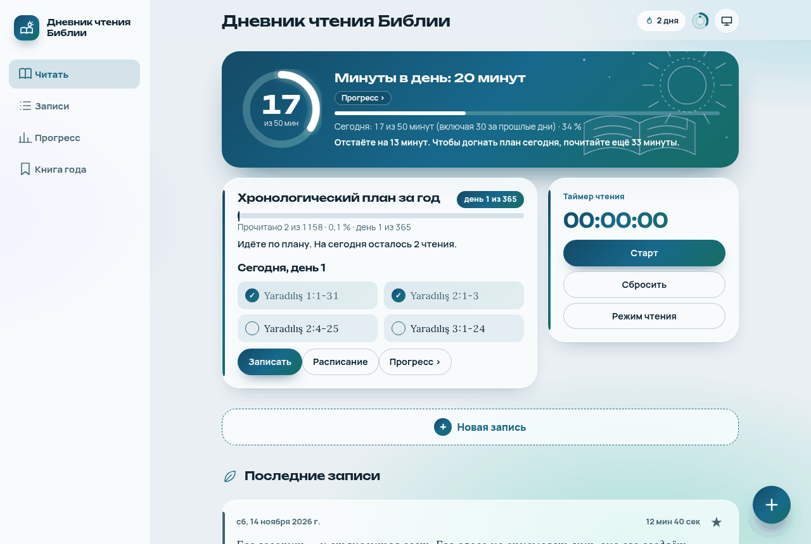
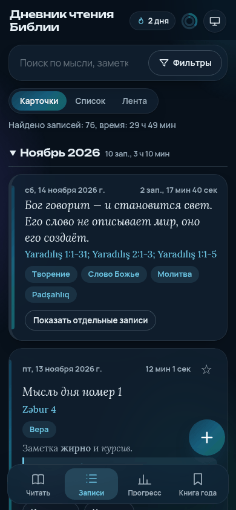
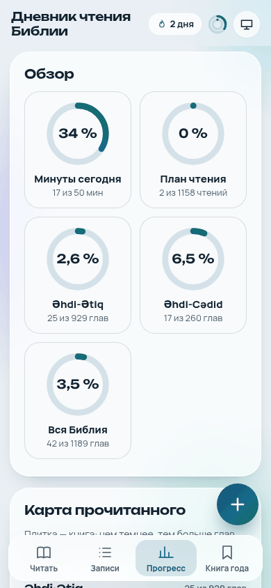
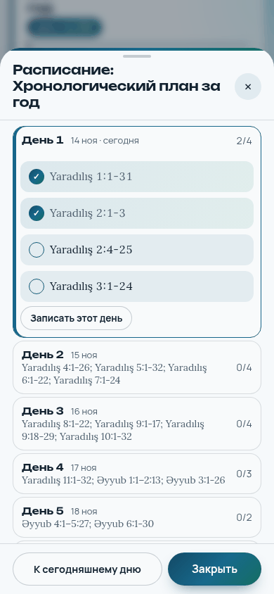
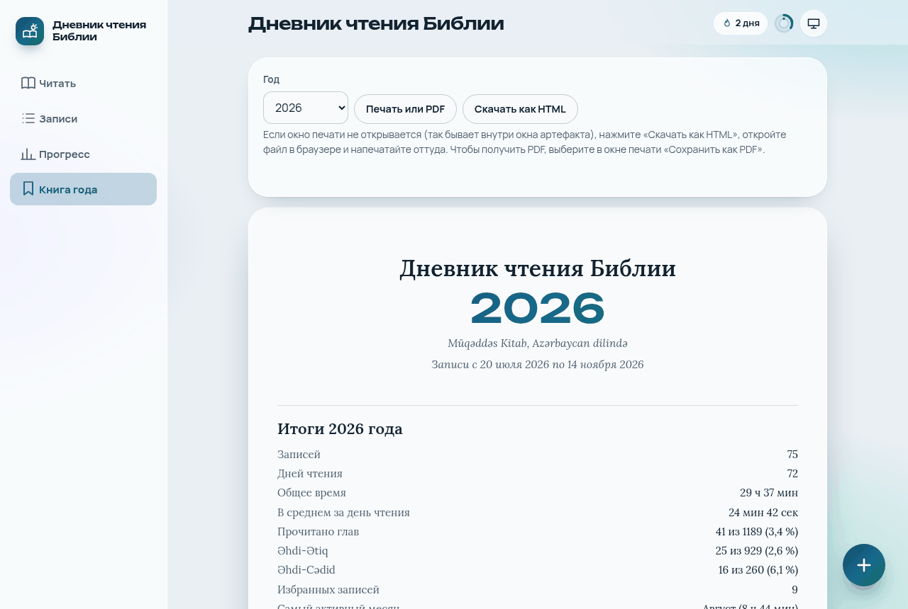

# Дневник чтения Библии

Личный дневник чтения Библии в одном HTML-файле. Записывайте, что прочитали, сколько времени это заняло и какая мысль осталась. Следите за планом и целями, а в конце года соберите «Книгу года». Интерфейс на русском, названия книг Библии — на азербайджанском (по нумерации азербайджанского перевода).

**Открыть:** https://rossh-gumngus.github.io/bible-diary/

Устанавливать ничего не нужно: страница работает в любом современном браузере на телефоне и компьютере.



| Записи (тёмная тема) | Прогресс | Расписание плана |
|---|---|---|
|  |  |  |

| Книга года | Синхронизация |
|---|---|
|  |  |

На снимках — демонстрационные данные.

## Возможности

- **Записи и разметка.** Дата, время чтения, отрывки (выбор книги, главы и стихов), ключевая мысль, заметка с **жирным** и *курсивом*, темы-метки, избранное. Поиск и фильтры; три вида списка: карточки, список, лента. Отмена удаления.
- **Таймер и режим чтения.** Таймер переживает перезагрузку страницы, а режим чтения убирает всё лишнее.
- **Темы оформления.** Светлая, тёмная или как в системе. Учитывается настройка «уменьшить движение».
- **Планы чтения.**
  - «Библия за 90 дней».
  - «Библия за 60 дней».
  - Хронологический план на год.
  У каждого плана есть отметки прочитанного, расписание по дням и подсказка, сколько осталось на сегодня.
- **Цели.** Минуты в день и/или план чтения. Видно, насколько вы опережаете план или отстаёте от него.
- **Прогресс.** Обзор, карта прочитанных книг и глав, тепловая карта, календарь, статистика времени, достижения.
- **Книга года.** Красивая сводка записей за год: можно напечатать, сохранить как PDF или скачать как HTML.
- **Резервная копия.** Экспорт всех записей в JSON и импорт: импорт добавляет записи и ничего не стирает.
- **Синхронизация с Google Диском (по желанию).** Записи объединяются между устройствами по каждой записи: побеждает более поздняя правка, удаления тоже доходят до других устройств. Когда нет сети, дневник работает как обычно, а синхронизация догоняет позже.

## Приватность

- Записи хранятся **только в вашем браузере** (localStorage). Сервера у дневника нет, аналитики и счётчиков нет.
- Шрифты встроены в файл, поэтому при обычной работе страница не обращается к сторонним сайтам.
- Если вы включите синхронизацию и нажмёте «Войти через Google», загрузятся Google Identity Services и Google Drive API. Дневник получит доступ **только к своей скрытой папке** на **вашем** Google Диске (appDataFolder, область `drive.appdata`): там лежит один файл `diary.json`. К остальным файлам на Диске у дневника доступа нет. Удалить эти данные можно в настройках Google Диска: Manage apps → Options → Delete hidden app data.
- «Выйти» отзывает доступ, а записи на устройстве остаются.

## Как включить синхронизацию

В опубликованной версии client ID не указан (`GOOGLE_CLIENT_ID = ''`), поэтому синхронизация выключена, а дневник полностью работает на одном устройстве. Чтобы её включить, нужен собственный OAuth client ID из Google Cloud. Пошаговая инструкция: **[docs/google-setup-ru.md](docs/google-setup-ru.md)**.

Коротко:
1. Создайте проект в Google Cloud.
2. Включите Google Drive API.
3. Настройте экран согласия (External, Testing) и добавьте себя в тестовые пользователи.
4. Создайте Web-клиент с origin `https://rossh-gumngus.github.io` (и `http://localhost:8000` для локальной проверки).
5. Впишите ID в `src/config.js` и пересоберите.

Открытие файла двойным щелчком (`file://`) для синхронизации не подходит.

## Сборка

`index.html` собирается из файлов в `src/`. Нужен только Python 3, без зависимостей:

```sh
python3 src/build.py                     # index.html со встроенными шрифтами
FONT_MODE=google python3 src/build.py    # вариант со шрифтами по ссылке Google Fonts (файл меньше)
```

Посмотреть локально:

```sh
python3 -m http.server 8000              # затем откройте http://localhost:8000/
```

Структура:

- `index.html` — готовое приложение (результат сборки);
- `src/`
  - `build.py` — сборка;
  - `config.js` — настройка `GOOGLE_CLIENT_ID`;
  - `app.js`, `ui.js`, `plan.js`, `sync.js` — логика;
  - `plans.js` — планы чтения (только ссылки на главы);
  - `*.css`, `head.html`, `body.html` — оформление и разметка;
  - `fonts/` — шрифты woff2 и их лицензии;
- `docs/` — инструкция по настройке Google;
- `screenshots/` — снимки экрана.

## Источники и благодарности

- **Число стихов в главах** и нумерация глав и стихов взяты из текста Библии на азербайджанском языке («Azərbaycan dilində Müqəddəs Kitab») с сайта [eBible.org](https://ebible.org/). В репозитории нет самого библейского текста: только количество стихов по главам и названия книг.
- **План «Библия за 90 дней»** основан на плане чтения YouVersion №13 [«Bible in 90 Days»](https://www.bible.com/reading-plans/13-bible-in-90-days) (Bible Gateway, Ted Cooper).
- **План «Библия за 60 дней»** основан на плане чтения YouVersion №12221 [«Power Read The Bible In 60 Days With Jeff Anderson»](https://www.bible.com/reading-plans/12221-power-read-the-bible-in-60-days-with-jeff-anderson) (Acceptable Gift, Inc.).
- Из этих планов взята только разбивка по дням (ссылки на главы и стихи), она приведена к нумерации азербайджанского перевода. Проект не связан с YouVersion, Life.Church, Bible Gateway или авторами планов и не одобрен ими. Все названия принадлежат их владельцам.
- **Хронологический план на год** составлен автором проекта.
- Шрифты: [Unbounded](https://github.com/googlefonts/unbounded), [Manrope](https://github.com/googlefonts/manrope), [Lora](https://github.com/cyrealtype/Lora-Cyrillic) (через Google Fonts).

## Лицензии

- Код — [MIT](LICENSE), © 2026 Rossh-gumngus.
- Шрифты Unbounded, Manrope и Lora — SIL Open Font License 1.1. Тексты лицензий лежат в `src/fonts/OFL-*.txt`, а шрифты встроены в `index.html`.
- Названия и разбивка планов чтения принадлежат их авторам (см. выше).
